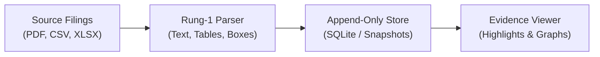
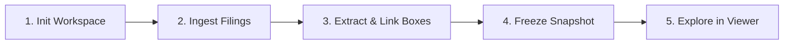

<p align="center">
  
</p>

<h1 align="center">GoCarbonTracker (gct)</h1>

<p align="center">
  <strong>An open-source workspace and evidence engine for corporate climate disclosures, tracing claims to document pages with an append-only audit trail.</strong>
</p>

<p align="center">
  <a href="LICENSE"></a>
  <a href="https://www.python.org/downloads/">= 3.11" /></a>
  
  
  
</p>

---

## Overview

Corporate sustainability reporting suffers from an **assurance deficit**:
* **Questionnaires fail to verify**: Scope 3 decarbonization programs rely heavily on questionnaires where suppliers check boxes without attaching verifiable proof.
* **Manual reading does not scale**: Analysts spend weeks combing through 150-page sustainability reports (PDF, BRSR, CSRD, GRI tables) to copy-paste numbers into spreadsheets. Transcription errors occur, and citation context is lost.
* **Restatements disappear**: Companies regularly adjust historical baseline figures in subsequent disclosures without drawing attention to the changes.

**GoCarbonTracker (`gct`)** is a local-first workspace and evidence engine. It ingests corporate sustainability filings, extracts quantitative climate metrics (Scope 1, Scope 2, Scope 3 categories, energy usage, targets), and **anchors every single claim directly to its exact page coordinate and bounding box on the original document**, backed by an append-only audit trail.

---

## Who is It For?

| Role | Operational Problem | How GoCarbonTracker Solves It |
| :--- | :--- | :--- |
| **Scope 3 & Procurement Leads** | Cannot meter suppliers' factories; questionnaire response rates are low and unverified. | Ingests suppliers' published reports; provides a queryable portfolio with page-level citations for every Scope 1, 2, and 3 metric. |
| **Sustainability Auditors** | Demands checkable evidence, not opaque AI summaries or unverified spreadsheets. | Provides an interactive click-to-highlight viewer that navigates straight to the source table cell or paragraph. |
| **Corporate Reporting Teams** | Prepares CSRD/SEC filings; needs to track multi-year baseline restatements and review history. | Automatically surfaces restatements across annual disclosure cycles with immutable change logs. |

---

## System Architecture

GoCarbonTracker is built as a **local-first, deterministic evidence pipeline**. It runs entirely on your local machine with zero external network dependencies required during core operations.



---

## Practitioner Workflow



---

## Installation

### Prerequisites
* **Python**: `>= 3.11` (Tested and benchmarked on Python 3.13 macOS Apple Silicon). Check with `python3 --version`.

### Option A: Standard User Installation
Installs `gct` into an isolated virtual environment:

```bash
# Clone the repository
git clone https://github.com/GoCarbonTracker/go-carbon-tracker.git
cd go-carbon-tracker

# Create and activate virtual environment
python3 -m venv .venv
source .venv/bin/activate

# Install package
pip install .

# Verify installation
gct --version
```

### Option B: Contributor & Developer Installation (with Test Suite)
Installs editable development dependencies, test harness, and build tools:

```bash
cd go-carbon-tracker
python3 -m venv .venv
source .venv/bin/activate

# Install editable with dev dependencies
pip install -e '.[dev]' 'setuptools>=77'

# Run the automated test suite (1,467 tests)
pytest
```

---

## Quickstart Tutorial

Follow this 5-minute walkthrough to initialize a workspace, ingest a disclosure, and explore the interactive evidence viewer.

### 1. Initialize a Workspace
```bash
gct workspace init company-audit
```
*Creates the workspace directory structure: SQLite database, file store, layout artifacts, published snapshots, and run logs.*

### 2. Register an Organisation
```bash
gct company add "Acme Global" --workspace company-audit
```

### 3. Add Corporate Disclosures
```bash
# Add reports (or use the included sample: examples/sample_sustainability_report.pdf)
gct doc add examples/sample_sustainability_report.pdf --company "Acme Global" --workspace company-audit
```
*The file is hashed with SHA-256. If duplicate bytes are uploaded under a different name, `gct` rejects the duplicate and references the original.*

### 4. Read Layout & Extract Claims
```bash
# 1. Deterministic text and table parsing
gct read --workspace company-audit

# 2. Extract quantitative emissions metrics and reduction targets
gct extract --workspace company-audit

# 3. Anchor claims to physical bounding boxes on the document page
gct link --workspace company-audit
```

### 5. Freeze Published Version Snapshot
```bash
gct publish build --workspace company-audit
```
*Freezes read-only data version `v1.db`. Any subsequent audit annotations or revisions generate `v2.db`.*

### 6. Launch the Local Interactive Evidence Viewer
```bash
gct serve --workspace company-audit
```
*Starts a secured local service and opens your default browser at `http://127.0.0.1:8765/?token=...`.*

* **Interactive Side-by-Side View**: Browse the claims table on the left; click any figure to jump directly to the PDF page on the right with the number highlighted in yellow.
* **Dual-Track Review**: Add company self-declarations, record auditor verifications, or flag restatements.
* **Explore Visual Graphs**: Open the **Graphs** tab to explore claims mapped across **Neighbourhood**, **Hypergraph**, and **Time-Series** views.

---

## Core Capabilities & Features

### 1. Zero-Model Layout Analysis (Rung 1)
* Operates locally using `pdfplumber`—no cloud API calls, zero token spend, and zero generative hallucination.
* Extracts numbers verbatim as printed (`1,234.5`, Indian numeric grouping, parenthetical negative accounting figures).
* Automatically audits page quality: flags scanned pictures (0 extractable text characters), fragmented text, or empty table matrices.

### 2. Physical Evidence Anchoring
Every claim stores coordinates in standard PDF points (`[x0, y0, x1, y1]`). Claims receive an unambiguous status:
* `matched`: Exact character and bounding box match within a detected table cell or text span.
* `cited`: Referenced in text or footnote without a discrete rectangular cell box.
* `unresolved`: Unanchored claim flagged for analyst inspection.

### 3. Multi-Year Harmonization & Restatement Engine
* Tracks metrics across multiple reporting cycles.
* Automatically surfaces historical restatements (e.g. when an organization revises its FY21 baseline in its FY24 annual filing).
* Stores explanatory footnotes and captures contributor rationales.

### 4. Double-Track Audit Ledgers
* Maintains independent ledgers: **Company Self-Declarations** vs. **Third-Party Auditor Reviews**.
* Neither track can overwrite the other. Divergences render an active visual disagreement band in the viewer.
* The underlying SQLite database prohibits SQL `UPDATE` and `DELETE` queries on audit history. Corrections are recorded as appended revisions.

### 5. Multi-View Graph Explorer (Cytoscape)
* **Neighbourhood Graph**: Visualizes a claim node linked to its source page, period, reporting boundary, and review state.
* **Hypergraph**: Models claims as hyperedges connected to shared hub members (e.g., shared document pages or organizational perimeters).
* **Time-Series Matrix**: Aligns multi-year figures across reporting cycles, making baseline shifts immediately obvious.

### 6. Audit-Ready Export Packages
* **JSON Schema Export**: `gct report all --format json` produces canonical machine-readable datasets validated against a public schema.
* **PDF with Evidence Crops**: `gct report all --format pdf` generates executive reports containing 150 DPI page crops of the exact source evidence.
* **Air-Gapped Privacy**: Sensitive documents default to `private`. Sanitized export packages strip out user identities, private files, and internal notes.

---

## CLI Command Summary

| Command Group | Command Syntax | Description |
| :--- | :--- | :--- |
| **Workspace** | `gct workspace init <PATH>` | Initialize a clean workspace directory and database. |
| | `gct workspace status` | Check schema version, document counts, and latest run status. |
| **Organisations** | `gct company add <NAME>` | Register an entity or supplier. |
| | `gct company list` | List registered entities. |
| **Documents** | `gct doc add <SOURCE...>` | Ingest PDF, CSV, or XLSX files (files, folders, or URLs). |
| | `gct doc list` | List active documents with SHA-256 hashes and quality flags. |
| | `gct doc delete <ID>` | Archive or permanently delete a document and purge derived data. |
| **Extraction** | `gct read` | Extract words, text layout, and ruled tables locally via `pdfplumber`. |
| | `gct extract` | Extract quantitative emissions and target claims. |
| | `gct link` | Map extracted claims to physical bounding boxes on document pages. |
| **Versioning** | `gct publish build` | Freeze current state into an immutable published snapshot (`vN.db`). |
| | `gct publish restore` | Roll back to the previous published snapshot. |
| **Viewer** | `gct serve [--port N]` | Launch the local authenticated web viewer. |
| **Reports** | `gct report all --format [json\|pdf\|page]` | Export evidence indexes, restatement logs, and gap reports. |
| **Packages** | `gct package create --confirm <TOKEN>` | Create a sanitized or complete workspace bundle for counterparties. |
| **Auditing** | `gct run list` / `gct run show <ID>` | Inspect execution history, retries, errors, and run parameters. |

---

## Milestone 2 Roadmap: HyperGraphRAG & Evidence Retrieval

Milestone 2 (M2) expands GoCarbonTracker from single-document extraction into an evidence-linked retrieval and multi-company intelligence engine:

* **Evidence-Linked HyperGraphRAG**: Natural language search and Q&A across multi-year corporate filings. Queries are strictly constrained by reporting period, organizational boundary, and metric definitions. Every answer cites exact source coordinates ($[x_0, y_0, x_1, y_1]$); if evidence is missing, GCT reports "insufficient evidence" rather than guessing.
* **Pluggable Jev Reranking (`jev-1.13.0`)**: Two-stage retrieval pairing local high-recall candidate extraction (BM25 + hypergraph index) with TypeSafe Jev for high-precision passage reranking and contradiction adjudication across conflicting claims.
* **Scope 3 Category 1 Supplier Networks**: Multi-company workspace portfolios mapping supplier-buyer disclosures, automated spreadsheet ingestion, and independent buyer-side reviews vs. supplier confirmations.

---

## Theoretical Foundations & Framework Alignment

### Research Foundations
* **Discourse Knowledge Graphs** ([Chan et al.](https://arxiv.org/abs/2105.00843)): Adapts discourse schemas to represent climate disclosures as structured networks of **Questions**, **Claims**, **Evidence**, and dialectical relations (*corroborates*, *restates*, *contradicts*).
* **Hypergraph Knowledge Networks** ([Gao et al.](https://arxiv.org/abs/2003.01853), [Sun et al.](https://arxiv.org/abs/2401.05489)): Represents disclosures as high-order hyperedges that simultaneously connect claims across document pages, reporting perimeters, multi-year time series, and supply-chain counterparties.

### Supported ESG Frameworks & Standards
* **CSRD / ESRS (E1 Climate Change)**: Scope 1, Scope 2 (market/location-based), Scope 3 Categories 1–15, baseline recalculation disclosures, and carbon targets.
* **GHG Protocol**: Corporate Accounting & Reporting Standard and Corporate Value Chain (Scope 3) Standard.
* **BRSR (SEBI India)**: Principle 6 Essential Environmental Indicators for listed corporate enterprises.
* **SEC Climate Rules & ISSB / IFRS S2**: Boundary consolidation rules, double-track assurance records, and multi-year restatement tracking.

## Documentation Index

Comprehensive documentation is available in the [`docs/`](docs/) directory:

* [**Architecture & Framework**](docs/framework.md) — The GCT climate assurance model, boundary rules, and double-track ledger.
* [**Extraction Methodology**](docs/methodology.md) — Rung-1 deterministic layout analysis, bounding box extraction, and restatement algorithms.
* [**Setup & Installation Guide**](docs/setup.md) — Offline installation, platform-specific notes, and cross-machine workspace transfer.
* [**Views & Visualization**](docs/views.md) — Details on the Tables and Graphs tabs, Cytoscape layouts, and saved views.
* [**Reporting & Exporting**](docs/reports.md) — Generating JSON Schema datasets, CSVs, and PDF evidence appendixes.
* [**Privacy & Data Governance**](docs/privacy.md) — Privacy labels, air-gapping, sanitization preview, and export limits.
* [**Troubleshooting & Run Logs**](docs/troubleshooting.md) — Error codes, recovery procedures, and generating diagnostic packages.

---

## Status & Operational Notice

This is **`v0.1.0-alpha` (Developer Preview)** experimental software. Please note the following verified acceptance boundaries:
* **Deterministic Rung-1 Baseline**: Extraction is strictly rule-based (`pdfplumber`). The baseline does not yet include OCR for scanned pages or generative model-based extraction rungs.
* **Privacy Limits in Sharing Features**: While sanitized packages exclude private documents and contributor names by default, note that PDF metadata, annotations, or fullwidth characters in database files are subject to limits documented in [docs/privacy.md](docs/privacy.md). Always review packages prior to sharing.

---

## License & Provenance

* Licensed under the [MIT License](LICENSE).
* See [ORIGINS.md](ORIGINS.md) for detailed patent, provenance, and dependency attribution notices.
