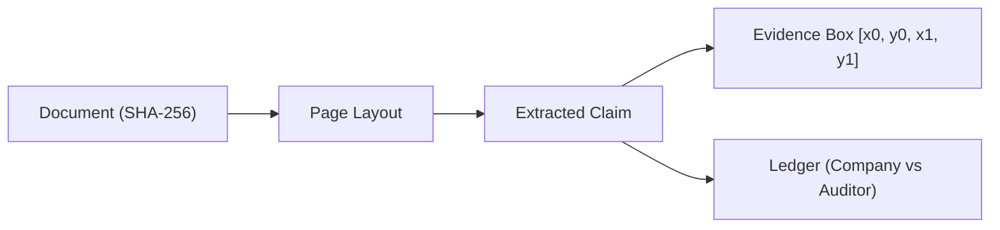
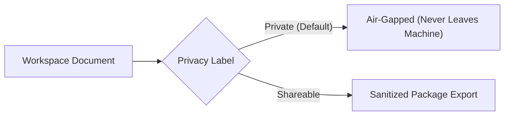

# GoCarbonTracker Climate Audit & Assurance Framework

This document outlines the conceptual framework governing **GoCarbonTracker (`gct`)**. It provides sustainability practitioners, assurance auditors, and Scope 3 procurement leaders with a transparent model for evaluating corporate climate evidence.

---

## 1. The Assurance Deficit in Corporate Climate Reporting

Corporate sustainability reporting faces an assurance deficit:
1. **The Questionnaire Fallacy**: Large enterprises manage supply chain decarbonization by circulating questionnaires. Suppliers check boxes and self-report numbers with no mandatory evidence attached.
2. **The Manual Reading Bottleneck**: Sustainability teams spend weeks combing through 150-page annual reports, BRSR filings, CSRD statements, and GRI tables to extract Scope 1, 2, and 3 figures. Human copy-paste introduces transcription errors, and citation context is lost once numbers enter an Excel model.
3. **The Disappearing Baseline Problem**: Companies routinely revise prior-year emissions due to acquisitions, methodological shifts, or changed emission factors. Without automated multi-year comparison, restatements slip past auditors unnoticed.

**GoCarbonTracker replaces self-reported claims with checkable, page-anchored evidence.**

---

## 2. Core Architectural Tenets

### 2.1 Physical Proof Over Synthetic Estimation
* Many ESG tools estimate corporate footprints by multiplying supplier procurement spend by secondary emission factors (e.g., EEIO models).
* GCT does not estimate. It captures **what entities officially reported about themselves**.
* Every claim must be tied to a physical document coordinate: a table cell or word span. If a number cannot be found in the document, it does not exist in the system.

### 2.2 The Double-Track Verification Ledger
To prevent bias, GCT maintains strictly independent review tracks:
* **Company Track**: Captures the exact assertion made by the reporting entity.
* **Assurance Track**: Captures findings, assurance scope, and discrepancies noted by third-party auditors.
* Neither track can overwrite the other. When they disagree, GCT renders an active visual divergence band rather than computing an artificial average.

### 2.3 Immutable Append-Only Ledger
* Environmental claims must withstand legal, regulatory (CSRD / SEC), and financial audits.
* The GCT database prohibits all SQL `UPDATE` and `DELETE` commands on claims data.
* If a figure is amended, a new version is created. The audit trail retains the previous value, the timestamp of change, the user identity, and the rationale.

---

## 3. Organizational & Reporting Boundaries

Emissions numbers are meaningless without their organizational perimeter. GCT categorizes claims across strict boundary definitions:

| Boundary Type | Definition | GCT Verification Rule |
| :--- | :--- | :--- |
| **Operational Control** | Full emissions from operations where the company directs operating policies. | Verified against facility lists and reporting footnotes. |
| **Financial Control** | Emissions proportioned according to financial control. | Verified against corporate parent consolidation rules. |
| **Equity Share** | Emissions based on economic interest percentage. | Requires explicit joint venture and associate accounting notes. |
| **Subsidiary / Single Facility** | Disclosure limited to a specific legal entity or factory. | Cannot be merged into group-level Scope 1 or 2 metrics. |

When comparing two reports, GCT evaluates whether the reporting boundary changed before flagging an apparent increase or decrease in emissions.

---

## 4. Privacy & Governance Guarantees

1. **Default Privacy**: All imported documents, notes, and claims default to `private`.
2. **Air-Gapped Execution**: The core M1 engine runs entirely on the host laptop. It does not phone home, collect telemetry, or transmit documents over the internet.
3. **Sanitized Sharing**: When generating export packages for counterparties or assurance partners, `gct` strips out internal user notes, reviewer identities, and private documents, producing verifiable audit bundles without leaking proprietary information.
