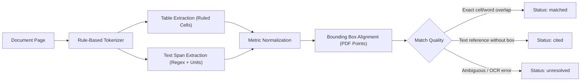
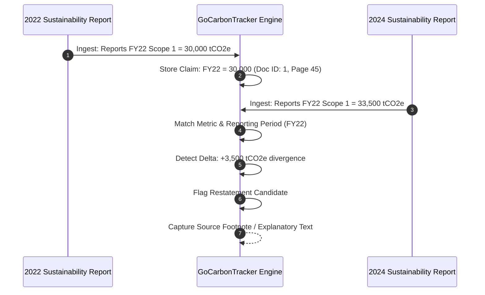

# GoCarbonTracker Extraction & Verification Methodology

This document details the engineering and data extraction methodology implemented in **GoCarbonTracker (`gct`)**. It defines how documents are parsed, how quantitative climate claims are extracted without hallucination, how physical bounding box coordinates are mapped, and how multi-year restatements are detected.

---

## 1. Principles of the Methodology

### 1.1 Zero-Model Determinism First (Rung 1)
Modern LLM pipelines frequently hallucinate figures, round numbers, or blend definitions across paragraphs. GoCarbonTracker enforces a **deterministic baseline (Rung 1)** before any statistical or generative model is introduced:
* Text, words, and ruled table grids are extracted using direct PDF layout analysis (`pdfplumber`).
* Numbers and units are captured verbatim as printed on the page.
* Coordinates are calculated in standard PDF typography points ($1/72$ inch), referenced from the top-left origin.

### 1.2 "Negative Results Are Stronger Claims"
In ESG assurance, reporting a false finding destroys trust. GCT adheres to the principle that an unverified claim must remain unverified:
* If a figure cannot be anchored to an exact bounding box, it is labelled `cited` (no box), never given an inferred or guessed position.
* When evidence is absent, GCT marks the claim as `unresolved`, rather than attempting to interpolate.
* A failure to extract is never reported as a disclosure gap by the company; extraction diagnostics and disclosure states are strictly decoupled.

---

## 2. Ingestion & Pre-Processing Pipeline

```mermaid
flowchart TD
    A["Source Document (PDF / CSV / XLSX)"] --> B["SHA-256 Content Hash"]
    B --> C{"Hash Exists in Registry?"}
    C -- "Yes" --> D["Reject Duplicate / Reuse Cached File"]
    C -- "No" --> E["Register in Document Registry"]
    E --> F["Page Quality Diagnostics"]
    F --> G["Quality Flags Check"]
    G --> H["Flag: Blank / Scanned Page (No Text)"]
    G --> I["Flag: Fragmented Text Layout"]
    G --> J["Flag: Empty Table Cells"]
    G --> K["Store Layout Artifacts (JSON)"]
```

### 2.1 SHA-256 Content Deduplication
Every document added via `gct doc add` is digested using SHA-256:
* Re-adding identical bytes under any filename is flagged as a duplicate and rejected.
* Adding a modified report under the same name creates an immutable new version while archiving the previous record.
* Documents downloaded from URLs are cached against their URL and content hash.

### 2.2 Page-Level Quality Audits
Before extraction begins, each page is evaluated against three quality criteria:
1. **Scanned Image Check**: Pages containing zero extractable text characters are flagged as scanned images (requiring OCR in later rungs).
2. **Text Fragmentation**: Pages where text is broken into isolated characters or erratic single-letter spans are flagged.
3. **Empty Table Matrix**: Grids with excessive empty cells or unruled matrices are marked for reviewer verification.

---

## 3. Claim Extraction & Bounding Box Mapping

### 3.1 Extraction Scope
The Rung-1 baseline targets core quantitative sustainability disclosures:
* **Greenhouse Gas Emissions**: Scope 1, Scope 2 (Location-based & Market-based), Scope 3 (Categories 1–15).
* **Energy Metrics**: Total energy consumption, renewable electricity share, MWh.
* **Reduction Targets**: Target percentages, base years, target completion years.

### 3.2 Verbatim Capture
Numbers are extracted exactly as formatted:
* **Western Grouping**: `1,234,567.89` parsed as standard float while preserving original string formatting.
* **South Asian Grouping**: Indian numbering formats (e.g. `1,23,456.00` Lakhs/Crores) preserve their printed form and unit multiplier.
* **Negative & Accounting Formats**: Parenthetical values like `(15,000)` are tracked as accounting subtractions.
* Numbers appearing in the top 5% or bottom 5% of a page (running headers, footers, page numbering) are suppressed to prevent noise.

### 3.3 Physical Bounding Box Anchoring
For every extracted claim, `gct` stores:
$$\text{Bounding Box} = [x_0, y_0, x_1, y_1]$$
* **Table cells**: When a figure sits inside a ruled cell, the bounding box encompasses the physical table cell boundary.
* **Text figures**: When a figure is part of a narrative sentence, the box encompasses the word tokens of the figure and its immediate unit.
* When rendered in the interactive viewer or exported to PDF, `pypdfium2` cuts high-resolution 150 DPI page crops based on these coordinates.

---

## 4. Multi-Year Harmonization & Restatement Tracking

Corporate climate reports routinely adjust historical baselines due to acquisitions, divestments, or updated emission factors. Many companies do not highlight these changes prominently.

### 4.1 Harmonization Logic
1. **Metric Matching**: Align claims that refer to the same emissions scope and organisational perimeter.
2. **Period Alignment**: Match claims reporting on identical fiscal or calendar periods (e.g., FY 2021-22).
3. **Delta Computation**:
   * If both reports publish identical figures, they are linked as corroborating evidence (`corroborated`).
   * If the figures differ, GCT creates a **Restatement Candidate** linking both source pages and highlights the revision for reviewer adjudication.

---

## 5. Review & Adjudication Protocol

Every claim in the database has an independent verification lifecycle:
* **Company Self-Declaration**: What the reporting organisation stated in its published disclosure.
* **Auditor Verification**: The assurance conclusion recorded by an independent assurance provider (e.g., Reasonable vs. Limited Assurance, ISO 14064-3, ISAE 3000/3410).
* **Adjudication Records**: When data conflicts arise between reports, an analyst or auditor records a structured adjudication with reasons (e.g., "Boundary expansion to include European subsidiary").
